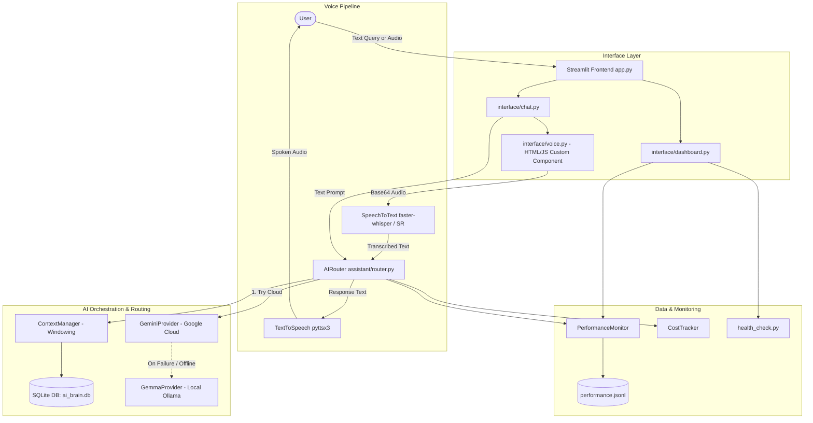

# AI Brain - System Architecture

## Architectural Overview

AI Brain is structured into distinct, modular layers: Presentation (Streamlit + Custom Web Component), Core Orchestration (AIRouter), Model Providers (Cloud Gemini + Local Gemma), Memory & Persistence (SQLite + Context Manager), and Observability (Performance Monitor + Cost Tracker).

## Core Components

### 1. Presentation Layer (`interface/`)
- **`app.py`:** Application entry point. Configures page layout, maintains session state, hosts the sidebar navigation and session selector, and delegates rendering to the appropriate sub-module.
- **`interface/chat.py`:** Renders chat message history, handles asynchronous user inputs, provides typed and voice interaction, and displays model attribution.
- **`interface/dashboard.py`:** Reads audit metrics from `data/logs/performance.jsonl` to render health widgets, average latency charts, RAM consumption curves, token/cost breakdowns, and interaction logs.
- **`interface/voice.py` & `voice_composer/index.html`:** Custom bidirectional Streamlit HTML/JS component providing real-time audio recording via the browser's MediaRecorder API.

### 2. Orchestration Layer (`assistant/router.py`)
- Coordinates the lifecycle of a prompt.
- Retrieves conversation history through `ContextManager` (bounded to top $N$ recent exchanges).
- Attempts execution with `GeminiProvider`; on any network timeout, connection error, or API rejection, seamlessly delegates to `GemmaProvider`.
- Collects execution metrics (duration, delta RAM, estimated cost) and appends them to both in-memory session history and the persistent JSONL log.

### 3. Provider Abstraction (`assistant/providers/`)
- **`base.py`:** `BaseProvider` abstract base class enforcing the contract `generate_response(prompt, history)`.
- **`cloud_gemini.py`:** Communicates with Google's Generative Language REST API (`/v1beta/models/{model}:generateContent`). Includes automatic model fallback (`gemini-2.5-flash`, `gemini-2.0-flash`, `gemini-1.5-flash`).
- **`local_gemma.py`:** Interfaces with an Ollama HTTP daemon on `localhost:11434` for local, private, offline execution of Gemma models.

### 4. Memory & Evaluation (`assistant/memory/`, `assistant/evaluation/`)
- **`conversation.py`:** Manages SQLite connection to `data/conversations/ai_brain.db` with auto-naming based on the first prompt, multi-session retrieval, and message persistence.
- **`context_manager.py`:** Truncates message histories to prevent token context overflow.
- **`performance.py`:** Profiles execution time using `time.perf_counter()` and process RSS memory with `psutil.Process()`.
- **`cost_tracker.py`:** Computes input/output token counts and estimates monetary cost according to Google Gemini pricing tiers.

